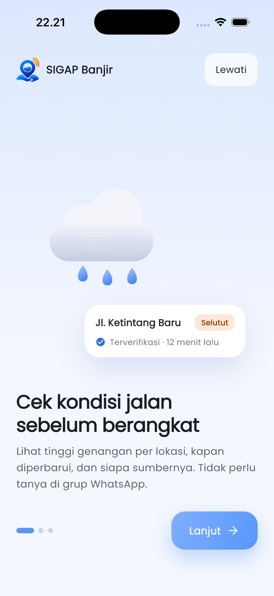
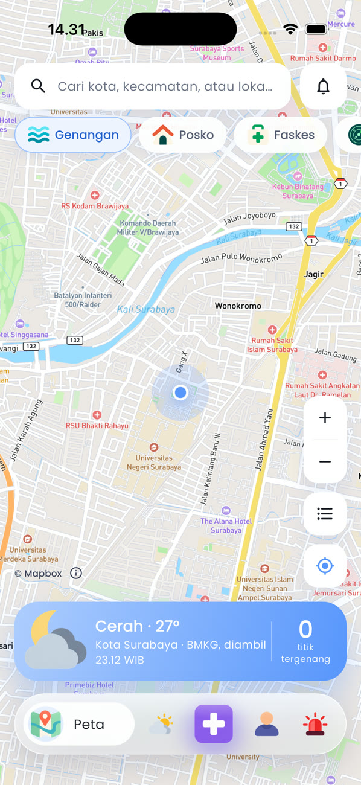
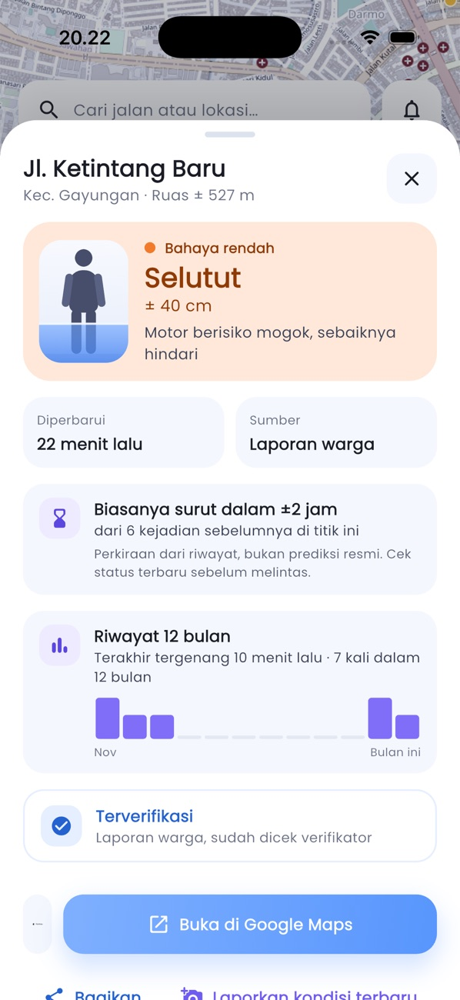
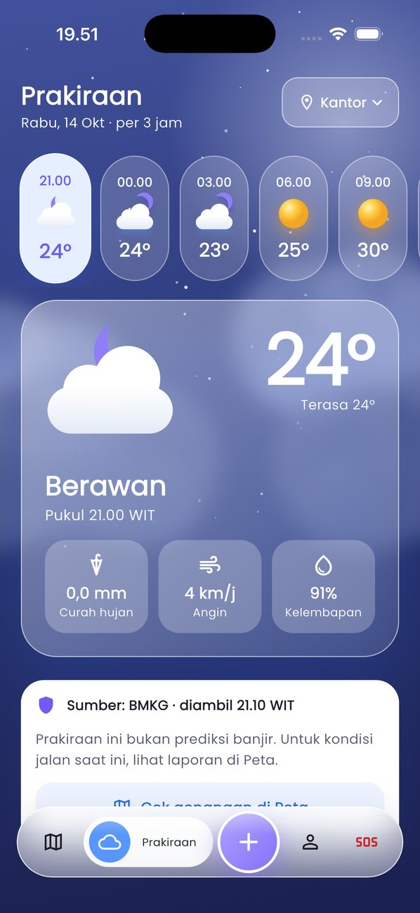
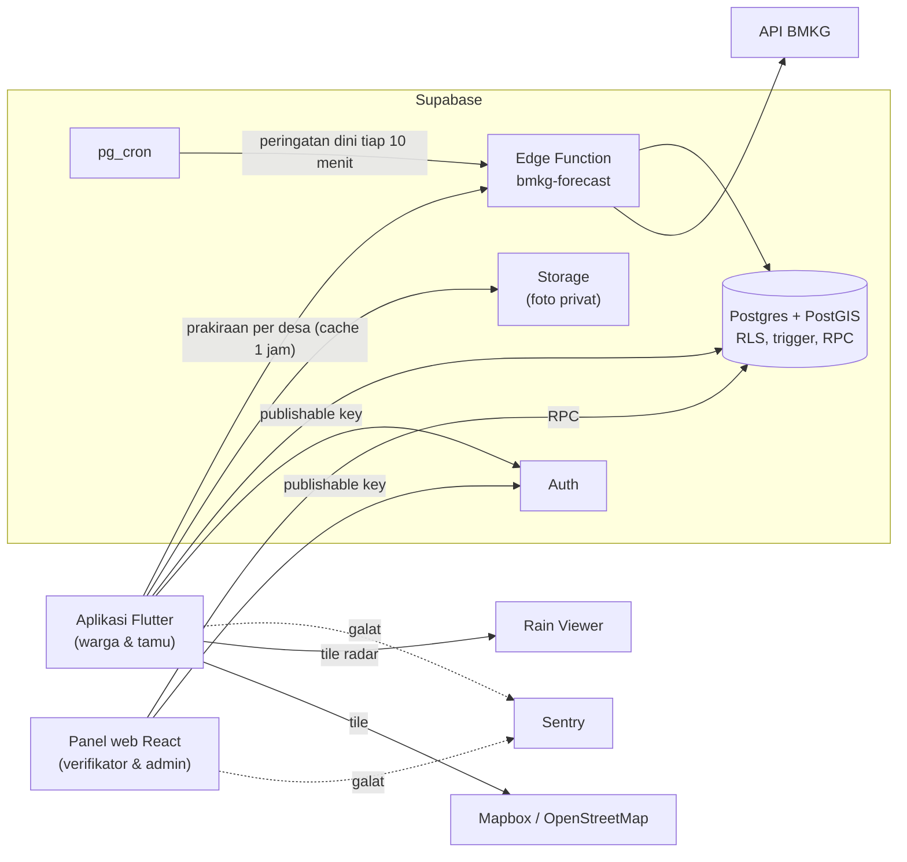

<div align="center">

# SIGAP Banjir

**Status genangan per lokasi untuk warga di seluruh Indonesia.**
Tinggi air, waktu pembaruan, dan sumbernya, supaya warga bisa memutuskan rute atau mengungsi sebelum terjebak.


<br>

&nbsp;
&nbsp;
&nbsp;


</div>

## Kenapa

Riset awalnya di Surabaya: warga dan komuter biasanya tahu ada banjir dari grup WhatsApp atau media sosial. Kabarnya sering terlambat, tidak menyebut titik lokasi, dan tidak jelas kebenarannya. Ketiga narasumber riset persona mengalami hal yang sama: baru tahu jalannya banjir saat sudah terjebak di sana.

SIGAP Banjir menjawab satu pertanyaan: **jalan atau lokasi ini aman dilalui atau tidak, dan siapa sumbernya.** Aplikasi ini lapisan informasi, bukan pengganti keputusan resmi BPBD. Prakiraan hujan diambil dari BMKG, dan kondisi lapangan berasal dari laporan warga yang selalu diberi label status verifikasi.

## Fitur

| | |
| --- | --- |
| **Peta genangan** | Titik dan ruas jalan tergenang di atas peta Mapbox/OpenStreetMap, bisa dicari per kelurahan, kecamatan, atau kota se-Indonesia. Warnanya mengikuti 5 tingkat ketinggian air (aman, semata kaki, selutut, sepinggang, sedada), selalu disertai teks dan ilustrasi, tidak hanya warna. |
| **Label sumber** | Setiap titik berlabel *Resmi*, *Terverifikasi*, atau *Belum Terverifikasi*. Laporan tanpa pembaruan lebih dari 3 jam otomatis menjadi *Perlu Konfirmasi* dan penandanya memudar. |
| **Laporan warga** | Foto (1–3), kategori ketinggian bergambar, dan lokasi GPS yang bisa digeser. Laporan dalam radius 100 m dari titik aktif digabung ke titik itu. Batasnya 5 laporan per jam per akun. |
| **Lokasi pantauan** | Simpan rumah, kampus, atau kantor (maksimal 5) dengan radius 500 m–2 km. Notifikasi hanya dari laporan *Terverifikasi* atau *Resmi* selutut ke atas, supaya tidak ada alarm palsu. |
| **Prakiraan BMKG** | Per 3 jam untuk desa/kelurahan mana pun di Indonesia (lokasi GPS, hasil cari, atau favorit seperti Rumah/Kantor), disimpan 1 jam di server, dengan jam sesuai WIB/WITA/WIT, perkiraan jam hujan reda, dan peringatan dini BMKG untuk area itu. |
| **Radar hujan** | Animasi radar 2 jam terakhir dari Rain Viewer. |
| **Riwayat & area rawan** | Estimasi lama surut (median, hanya jika ada ≥ 5 kejadian), grafik kejadian 12 bulan, dan lapisan area rawan. |
| **Darurat** | Panggil 112 sekali ketuk, kontak nasional (BNPB, Basarnas) ditambah BPBD dan layanan kab/kota tempatmu berada, posko serta faskes terdekat, dan panduan siaga banjir yang tetap bisa dibuka offline. |
| **Panel web** | Verifikator meninjau antrean laporan untuk kab/kota yang ditugaskan kepadanya (foto, peta mini, reputasi pelapor yang disamarkan, tanda duplikat, koreksi kategori), menandai surut, dan menerbitkan status *Resmi* dari BPBD/Pemkot. Admin nasional mengatur wilayah tugas verifikator, mengelola posko, faskes, kontak darurat, peran dan blokir akun, ambang notifikasi, serta melihat log aktivitas. |
| **Verifikasi per wilayah** | Verifikator ditugaskan per kab/kota dan hanya bisa meninjau laporan di wilayahnya. Di kab/kota yang belum punya verifikator, titik otomatis menjadi *Terverifikasi* bila ≥ 3 akun berbeda melaporkannya dalam 1 jam (berlabel "terverifikasi otomatis"). Admin melihat daftar wilayah tanpa verifikator di dasbor. |
| **Moderasi foto** | Warga bisa melaporkan foto yang tidak pantas, bukan genangan, atau memuat data pribadi. Foto yang dilaporkan 3 akun disembunyikan sementara sampai petugas memutuskan di panel. |
| **Data se-Indonesia** | 83 ribu desa/kelurahan untuk pencarian dan prakiraan, 6.200+ RS dan puskesmas dari OpenStreetMap, serta impor CSV di panel untuk nomor BPBD dan posko dari sumber resmi. |
| **Mode Tamu** | Peta, prakiraan, dan posko bisa dilihat tanpa daftar. Login hanya diminta untuk melapor dan memantau. |

## Arsitektur



Hampir semua aturan bisnis dijaga di database, bukan di aplikasi:

- **RLS di setiap tabel.** Koordinat pelapor hanya bisa dibaca pemiliknya dan verifikator, sementara warga lain hanya melihat titik genangan.
- **Trigger laporan** menegakkan batas 5 laporan per jam, mewajibkan foto berada di folder pemiliknya, dan menggabungkan laporan dalam radius 100 m.
- **Wilayah tugas** (`staff_regions`, `can_review`): verifikator hanya membaca dan meninjau laporan di kab/kota tugasnya, admin nasional melihat semua.
- **Trigger verifikasi otomatis** menyetujui laporan bila cukup banyak warga berbeda melapor di titik yang sama dan wilayahnya tanpa verifikator; kategori diambil dari median laporan.
- **Trigger notifikasi** hanya berjalan saat titik menjadi *Terverifikasi/Resmi* selutut ke atas, atau saat titik surut.
- **Aksi panel lewat RPC & trigger.** Setujui/tolak, tandai surut, status Resmi, ubah peran, blokir, dan ubah pengaturan dicatat ke log aktivitas oleh database; klien tidak bisa menulis log sendiri.
- **Ambang & batas di tabel `app_settings`.** Batas laporan per jam, radius gabung, batas "Perlu Konfirmasi", dan ambang notifikasi diubah Admin dari panel tanpa deploy ulang.
- **pg_cron** menandai laporan basi tiap 10 menit, menghitung ulang area rawan tiap hari, dan mengambil peringatan dini BMKG tiap 10 menit. Prakiraan diambil per desa saat dibutuhkan, dengan kuota bersama 50 permintaan/menit.

## Struktur repo

```
mobile/                 Aplikasi Flutter
  lib/data.dart         Model + akses Supabase
  lib/state.dart        State & navigasi
  lib/motion.dart       Animasi bersama (menghormati "Kurangi Gerakan")
  lib/screens/          14 layar: peta, prakiraan, lapor, akun, darurat, …
  assets/guide.json     Panduan siaga (offline)
  map-style/            Gaya peta "SIGAP Banjir Light" untuk Mapbox Studio + pembangunnya
  branding/icon.svg     Sumber ikon aplikasi
web/                    Panel web Verifikator & Admin (Vite + React + Leaflet)
  src/pages/            Dasbor, antrean, status lokasi, posko/kontak, pengguna
  public/privasi.html   Kebijakan privasi (publik, tanpa login)
supabase/
  migrations/           Skema, RLS, trigger, RPC, storage, jadwal cron
  functions/            Edge Function bmkg-forecast
  data/build_regions.py Pembangun migrasi data wilayah se-Indonesia
  data/build_faskes.py  Pembangun migrasi RS & puskesmas dari OpenStreetMap
  seed.sql              Faskes & kontak darurat awal
docs/screenshots/
```

## Menjalankan

Yang dibutuhkan: [Flutter](https://docs.flutter.dev/get-started/install) 3.41+, [Supabase CLI](https://supabase.com/docs/guides/local-development/cli/getting-started), dan proyek Supabase.

**1. Backend**

```bash
supabase login
supabase link --project-ref <project-ref>
supabase db push --include-seed
supabase functions deploy bmkg-forecast
supabase config push
```

Jadwal BMKG membaca dua secret dari Vault. Jalankan sekali di SQL editor:

```sql
select vault.create_secret('https://<project-ref>.supabase.co', 'project_url');
select vault.create_secret('<SECRET_KEY>', 'functions_secret_key');
```

**2. Aplikasi**

```bash
cd mobile
cp env.example.json env.json   # SUPABASE_URL, SUPABASE_PUBLISHABLE_KEY, MAPBOX_TOKEN (opsional: MAPBOX_STYLE, SENTRY_DSN)
flutter pub get
flutter run --dart-define-from-file=env.json
```

`env.json` tidak masuk git. Aplikasi hanya memakai publishable key; secret key tinggal di Vault dan Edge Function.

**3. Panel web**

```bash
cd web
cp .env.example .env.local     # isi sama dengan mobile/env.json
npm install
npm run dev
```

Panel hanya bisa dimasuki akun berperan Verifikator atau Admin. Admin pertama diangkat sekali lewat SQL editor:

```sql
update public.profiles set role = 'admin'
where id = (select id from auth.users where email = '<email-kamu>');
```

Admin berikutnya dan Verifikator bisa diatur dari halaman Pengguna di panel.

**4. Tes**

```bash
cd mobile && flutter test
```

Tes membuka semua layar beserta transisinya di layar 402 dp dan 360 dp dengan ukuran huruf 130%.

**5. Build rilis**

```bash
cd mobile
flutter build appbundle --release --dart-define-from-file=env.json   # Play Store
flutter build ipa --release --dart-define-from-file=env.json         # App Store
```

Android menandatangani dengan kunci upload dari `android/key.properties` (tidak masuk git; tanpa file ini dipakai kunci debug). Kebijakan privasi untuk halaman toko: https://sigap-banjir-panel.vercel.app/privasi.html

## Status

- [x] Aplikasi mobile: 14 layar, mode Tamu, animasi transisi, navbar kaca, latar cuaca beranimasi
- [x] Backend Supabase: skema, RLS, laporan, verifikasi, notifikasi (data), prakiraan BMKG
- [x] Panel web Verifikator & Admin: RPC dan log aktivitas di database
- [x] Se-Indonesia: wilayah Kemendagri, prakiraan & peringatan dini per desa, verifikator per kab/kota, faskes OSM, impor CSV
- [x] Moderasi: verifikasi otomatis oleh warga, laporkan foto
- [x] Cache peta offline setelah aplikasi ditutup: tile yang pernah dilihat (30 hari) dan data terakhir (titik, posko, kontak, area rawan, prakiraan)
- [x] Siap rilis: ikon & splash, tanda tangan rilis, kebijakan privasi, laporan galat (Sentry, opsional)
- [x] Panel web online: https://sigap-banjir-panel.vercel.app
- [ ] Notifikasi push (FCM)
- [ ] Nomor BPBD kab/kota se-Indonesia (diimpor dari sumber resmi lewat panel)

## Sumber data

- Prakiraan cuaca: **BMKG** (`api.bmkg.go.id`). Sumbernya dicantumkan di setiap tampilan prakiraan.
- Peta: **© Mapbox** dan **© OpenStreetMap contributors**.
- Kode & titik tengah wilayah se-Indonesia (Kepmendagri 2025): **[cahyadsn/wilayah](https://github.com/cahyadsn/wilayah)** dan **[cahyadsn/wilayah_boundaries](https://github.com/cahyadsn/wilayah_boundaries)**, lisensi MIT © cahya dsn. Dibangun ulang dengan `supabase/data/build_regions.py`.
- Rumah sakit & puskesmas: **© OpenStreetMap contributors** (ODbL), lewat Overpass API. Dibangun ulang dengan `supabase/data/build_faskes.py`; atribusi tampil di detail faskes.
- Radar hujan: **Rain Viewer**, untuk penggunaan non-komersial.
- `seed.sql` hanya berisi beberapa faskes dan kontak darurat contoh. Titik genangan berasal dari laporan warga atau status Resmi; posko dan nomor BPBD diisi Admin dari sumber resmi lewat panel (formulir atau impor CSV). Cek alamat dan nomor ke sumber resmi sebelum rilis.

## Latar belakang

Proyek pribadi Adrian Faishal Hilmy. Berawal dari riset user persona untuk mata kuliah Desain Interaksi (Kelompok 4, Sistem Informasi, Universitas Airlangga): wawancara tiga narasumber warga dan komuter Surabaya. Prinsip desain interaksinya merujuk Alsabhan & Dudin (2023), *Real-Time Flood Forecasting and Warning: A Comprehensive Approach toward HCI-Centric Mobile App Development*, Multimodal Technologies and Interaction 7(5), 44. Proyek ini mendukung **SDG 11 Target 11.5**: mengurangi dampak bencana terkait air pada warga kota.
